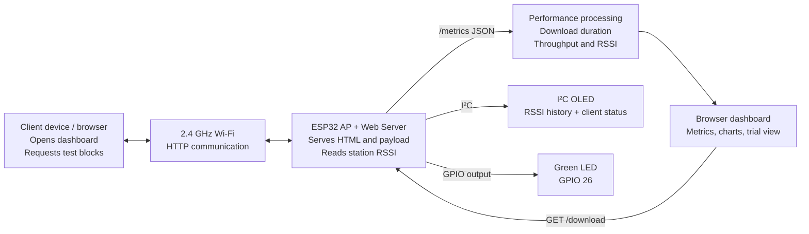
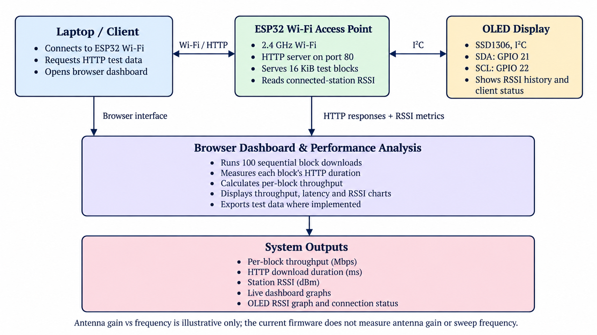
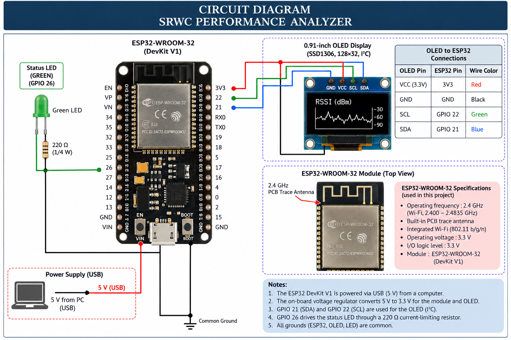

# DATA PERFORMANCE ANALYZER
### ESP32-based Short-Range Wireless Communication Performance Monitor

The **DATA PERFORMANCE ANALYZER** is an embedded Wi-Fi measurement project. An ESP32 runs as a Wi-Fi access point (AP) and serves a browser dashboard. A client connects to the AP and runs HTTP data-transfer trials. The dashboard measures block-download duration and calculates application-level throughput, while the ESP32 reports the connected station's RSSI. An I²C OLED displays recent RSSI history and client connection status.

> **Important:** This project does not directly measure antenna gain or pure radio round-trip time (RTT). Any antenna-gain-versus-frequency curve made with example values must be labelled *illustrative, not measured*.

## Table of Contents

1. [Overview](#1-overview)
2. [Features](#2-features)
3. [Block Architecture](#3-block-architecture)
4. [Components Required](#4-components-required)
5. [Circuit Diagram and Wiring](#5-circuit-diagram-and-wiring)
6. [Pins, Ports, Wi-Fi and URLs](#6-pins-ports-wi-fi-and-urls)
7. [Software Requirements](#7-software-requirements)
8. [Installation and Upload](#8-installation-and-upload)
9. [Connect to the Dashboard](#9-connect-to-the-dashboard)
10. [Run a Trial](#10-run-a-trial)
11. [How It Works](#11-how-it-works)
12. [Metrics and Formulas](#12-metrics-and-formulas)
13. [Testing and Results](#13-testing-and-results)
14. [Antenna-Gain Graph Limitation](#14-antenna-gain-graph-limitation)
15. [Troubleshooting](#15-troubleshooting)
16. [Safety and Good Practice](#16-safety-and-good-practice)
17. [Limitations and Future Work](#17-limitations-and-future-work)
18. [References](#18-references)

---

## 1. Overview

The project offers a simple, low-cost way to study wireless link performance across distance, orientation and obstacles. The ESP32 creates a local Wi-Fi network and serves a dashboard over HTTP. The browser requests fixed-size data blocks, times the downloads and calculates throughput. The ESP32 reads RSSI information for the connected client and exposes it to the dashboard. An OLED shows a rolling RSSI graph and connection state.

## 2. Features

- ESP32 Wi-Fi access point and HTTP web server.
- Dashboard served directly by the ESP32; no separate web server is required.
- Fixed-size HTTP test payload and repeated block-download trials.
- Throughput calculation using actual bytes received and elapsed time.
- Live client connection and RSSI reporting.
- OLED RSSI history and connection status.
- GPIO-controlled green status LED.
- Dashboard charts for available throughput, download-duration and RSSI samples.
- Optional antenna gain-versus-frequency chart, clearly labelled illustrative unless real antenna data is supplied.

## 3. Block Architecture


### Block Architecture Diagram



*Figure: System architecture showing the client, ESP32 access point, performance processing, dashboard, OLED and LED.*

**Data flow:** The ESP32 starts its AP and web server. The client connects and opens the dashboard. The dashboard polls `/metrics` and, during a trial, repeatedly requests `/download`. Browser timing is used to calculate throughput. The ESP32 updates the OLED about once per second.

## 4. Components Required

| Component | Quantity | Purpose |
|---|---:|---|
| ESP32 development board | 1 | Wi-Fi AP, HTTP server and RSSI reporting |
| USB data cable | 1 | Programming and power; charge-only cables may not work |
| 0.91-inch I²C OLED | 1 | Assumed SSD1306, 128×32 pixels, address `0x3C`; verify your module |
| Green LED | 1 | Status output |
| 220 Ω resistor | 1 | LED current limiting |
| Breadboard and jumper wires | As needed | Prototyping |
| Laptop/PC or other Wi-Fi client | 1 | Browser and data-transfer tests |

The assumed wiring and display settings must be checked against your actual board. ESP32 board and antenna variants differ.

## 5. Circuit Diagram and Wiring

### Text circuit diagram

```text
                    USB data cable
             Computer ------------- ESP32 DevKit
                                      |
        +-----------------------------+--------------------+
        |                             |                    |
      3V3 -------------------------- OLED VCC              |
      GND -------------------------- OLED GND              |
      GPIO 22 (SCL) ---------------- OLED SCL              |
      GPIO 21 (SDA) ---------------- OLED SDA              |
        |                                                  |
      GPIO 26 ----[ 220 Ω ]---->|---- GND                 |
                               Green LED                   |
        +--------------------------------------------------+
```

### Circuit Diagram



*Figure: ESP32 wiring for the OLED display, status LED, resistor and USB power.*

### OLED wiring

| OLED pin | ESP32 pin | Function |
|---|---|---|
| `VCC` | `3V3` | Power |
| `GND` | `GND` | Common ground |
| `SCL` | `GPIO 22` | I²C clock |
| `SDA` | `GPIO 21` | I²C data |

### LED wiring

Connect **GPIO 26 → 220 Ω resistor → LED anode (long leg)**; connect the LED cathode (short leg/flat side) to **GND**. The resistor can be placed on either side of the LED as long as it is in series.

**Electrical notes**
- Disconnect USB power before changing wiring.
- Do not connect 5 V to an ESP32 GPIO.
- Use 3V3 for the OLED unless its own documentation explicitly specifies otherwise.
- All connected components must share a common ground.
- Board header layouts vary; follow labels on your own board.

## 6. Pins, Ports, Wi-Fi and URLs

### GPIO and interface reference

| Item | Value | Description |
|---|---|---|
| OLED SDA | GPIO 21 | I²C data |
| OLED SCL | GPIO 22 | I²C clock |
| Green LED | GPIO 26 | Digital output |
| OLED address | `0x3C` | Assumed firmware address |
| Serial monitor | `115200` baud | Startup messages |
| HTTP server | TCP port `80` | Dashboard and endpoints |
| Wi-Fi band | 2.4 GHz | Exact channel depends on configuration/runtime |

### Default network details

| Setting | Value |
|---|---|
| SSID | `SRWC-ESP32` |
| Password | `SRWC12345` |
| AP IP | Usually `192.168.4.1` |
| Dashboard | `http://192.168.4.1/` |
| RSSI/client metrics | `http://192.168.4.1/metrics` |
| Test payload | `http://192.168.4.1/download` |
| LED ON | `http://192.168.4.1/led/on` |
| LED OFF | `http://192.168.4.1/led/off` |

These are the defaults in the current firmware. The credentials are for demonstration; change them if the network will be used beyond a controlled test.

### Windows COM port

The COM number is assigned by Windows and can change. **COM9 is correct only if Windows currently assigns the ESP32 to COM9.**

1. Connect the ESP32 with a USB data cable.
2. Open **Device Manager → Ports (COM & LPT)**.
3. Identify the port that appears for the board.
4. In Arduino IDE, choose **Tools → Port → the detected port**.
5. If no port appears, try another cable/USB port and check the USB-to-serial driver required by your board.

## 7. Software Requirements

- Arduino IDE 2.x or a compatible Arduino build environment.
- ESP32 board support package from Espressif.
- Appropriate USB-to-serial driver if needed (board-dependent, e.g. CP210x or CH340).
- Libraries:
  - `Adafruit GFX Library`
  - `Adafruit SSD1306`
- ESP32/Arduino headers used by the firmware: `Arduino.h`, `WiFi.h`, `WebServer.h`, `esp_wifi.h`, and `Wire.h`.

The dashboard HTML, CSS and JavaScript are embedded in the firmware source. A separate Node.js or web-hosting service is not required.

## 8. Installation and Upload

1. **Wire the circuit.** Connect the OLED and LED as shown above.
2. **Install the ESP32 board package.** In Arduino IDE, open **Tools → Board → Boards Manager**, search for `esp32` by Espressif Systems, and install it.
3. **Install libraries.** Open **Sketch → Include Library → Manage Libraries** and install Adafruit GFX Library and Adafruit SSD1306. Accept required dependencies.
4. **Open the firmware.** Use the project source. For Arduino IDE, put the source in a compatible sketch folder; a typical sketch uses a `.ino` file matching the folder name. For PlatformIO, `src/main.cpp` is the usual source location.
5. **Select the board.** Choose the board matching your hardware. `ESP32 Dev Module` is often suitable for ESP32-WROOM DevKit boards, but verify your exact model.
6. **Select the COM port.** Choose the port shown by Device Manager.
7. **Compile and upload.** Click Verify, fix missing-library or board errors, then click Upload.
8. **If upload hangs at “Connecting…”.** Try holding the board's `BOOT` button when connecting begins and release it once writing starts, if required by your board.
9. **Check Serial Monitor.** Set it to `115200` baud. Look for OLED initialization and AP startup messages, including the dashboard IP.
10. **Confirm the OLED.** If it remains blank, check power, ground, SDA/SCL, display compatibility and I²C address.

## 9. Connect to the Dashboard

1. On the client, connect to Wi-Fi network **`SRWC-ESP32`**.
2. Enter password **`SRWC12345`**.
3. Open a browser at **`http://192.168.4.1/`**.
4. Wait for the connection indicator and RSSI to update.
5. Keep the client connected to this AP while testing.

The client may display “No internet.” That is expected for a local test AP; internet access is not required.

## 10. Run a Trial

1. Start at 1 m with clear line of sight.
2. Keep the ESP32 and client orientation fixed.
3. Confirm the dashboard indicates a connected client.
4. Start the block-transfer test using the dashboard controls.
5. Wait for the trial to finish without disconnecting or navigating away.
6. Record distance, throughput, average download duration, RSSI and failed blocks if displayed.
7. Repeat at least three times per distance.
8. Repeat at 2 m, 3 m, 5 m, 10 m and other practical distances.
9. Test obstacles or orientation separately, changing one condition at a time.
10. Clearly mark any untested values as **estimated—not measured**.

### Test payload size

The current source defines `BLOCK_SIZE = 16 * 1024` bytes, which is **16,384 bytes (16 KiB)**. Where the dashboard's 100-block trial loop is used, the intended total is:

- `100 × 16,384 = 1,638,400 bytes`
- `1,638,400 bytes = 1.5625 MiB` (about 1.64 MB in decimal units)

Calculate throughput using the actual bytes received. Do not count failed requests as successful blocks.

## 11. How It Works

### ESP32 firmware

- Configures the ESP32 in AP mode.
- Creates the `SRWC-ESP32` Wi-Fi network.
- Builds a 16 KiB payload of ASCII `A` characters.
- Serves the dashboard at `/`.
- Serves the payload at `/download`.
- Reports connected-client RSSI and client count as JSON at `/metrics`.
- Controls the LED at `/led/on` and `/led/off`.
- Refreshes OLED RSSI history and connection state approximately once per second.

### Browser dashboard

- Polls `/metrics` for RSSI and client count.
- Requests `/download` during a test.
- Times each HTTP request and response-body read with the browser timer.
- Calculates throughput from the number of bytes received and elapsed time.
- Displays available live metric samples and trial results.

### OLED

The OLED uses I²C and shows a rolling RSSI graph plus a compact connected/disconnected status. It does not measure antenna gain or display throughput in the current firmware.

## 12. Metrics and Formulas

### RSSI

RSSI means **Received Signal Strength Indicator**. The ESP32 reads the RSSI associated with the connected Wi-Fi station. RSSI is commonly expressed in dBm; a value closer to zero generally represents a stronger received signal. RSSI is not a direct distance measurement.

### Throughput

\[
\text{Throughput (Mbps)} =
\frac{\text{Bytes received}\times 8}
{\text{Elapsed seconds}\times 10^6}
\]

### Elapsed time

\[
t_{\text{elapsed}} = t_{\text{end}} - t_{\text{start}}
\]

\[
t_{\text{ms}} = 1000 \times t_{\text{elapsed (seconds)}}
\]

This is the browser-measured HTTP download interval, including network, HTTP, server and processing overhead.

### Power conversion

\[
P_{\text{dBm}} = 10\log_{10}\left(\frac{P_{\text{mW}}}{1\text{ mW}}\right)
\]

This formula does not mean that the project directly measures transmit power or antenna gain.

### Wavelength

\[
\lambda = \frac{c}{f}
\]

where \(c \approx 3\times10^8\) m/s. At 2.4 GHz, wavelength is approximately **12.5 cm**.

### Free-space path loss

For distance \(d\) in kilometres and frequency \(f\) in MHz:

\[
FSPL(\text{dB}) = 20\log_{10}(d) + 20\log_{10}(f) + 32.44
\]

This is an ideal free-space estimate; indoor environments can behave differently.

### Log-distance path-loss model

\[
P_r(d) = P_r(d_0) - 10n\log_{10}\left(\frac{d}{d_0}\right)
\]

Here \(P_r(d)\) is received power at distance \(d\), \(d_0\) is a reference distance, and \(n\) is an environment-dependent path-loss exponent. Estimating \(n\) requires measurements at multiple distances.

### Latency terminology

The dashboard's block duration is **HTTP download duration**, not pure round-trip time (RTT). A dedicated request/response echo test is needed to measure RTT with a defined timing method.

## 13. Testing and Results

For reliable comparisons:

- Measure distance rather than guessing it.
- Keep client and ESP32 orientation consistent.
- Note walls, obstacles, interference and other environmental conditions.
- Run at least three trials at each distance.
- Record failed transfers as well as successful ones.
- Compare repeated measurements and their variation.
- Never invent missing values; use `Not measured` or label estimates explicitly.

Suggested results table:

| Trial | Distance (m) | Throughput (Mbps) | Avg. HTTP duration (ms) | Avg. RSSI (dBm) | Failed blocks | Status |
|---:|---:|---:|---:|---:|---:|---|
| 1 | 1.0 | Actual result | Actual result | Actual result | Actual result | Measured |
| 2 | 3.0 | Actual result | Actual result | Actual result | Actual result | Measured |
| 3 | 5.0 | — | — | — | — | Not measured until tested |
| 4 | 10.0 | — | — | — | — | Not measured until tested |

## 14. Antenna-Gain Graph Limitation

Antenna gain describes how effectively an antenna radiates or receives energy in a direction relative to a reference antenna, commonly expressed in dBi.

**The current firmware does not measure antenna gain and does not sweep radio frequency.** It reports RSSI and HTTP transfer performance. Therefore:

- Synthetic graph values must be labelled **illustrative only**.
- Do not present an illustrative curve as measured results or as the specification of the installed antenna.
- Identify the exact ESP32 module/antenna model before using manufacturer gain data.
- Actual gain measurements require a suitable calibrated RF test setup.
- RSSI and throughput cannot be converted directly into antenna gain without a separate calibrated method.

The ESP32 operates in the 2.4 GHz Wi-Fi band for this project. Verify the actual Wi-Fi channel/frequency from runtime configuration or suitable diagnostic tools rather than assuming one exact frequency.

## 15. Troubleshooting

| Problem | What to check |
|---|---|
| No COM port | USB data cable, another USB socket, Device Manager, correct serial driver |
| Upload fails | Correct board/port, close Serial Monitor, try BOOT-button procedure if needed |
| SSID not visible | Reset board; check Serial Monitor at 115200 baud; confirm upload succeeded |
| Dashboard won't open | Connect to `SRWC-ESP32`; use `http://192.168.4.1/`; temporarily disable interfering VPN/proxy |
| Dashboard says disconnected | Check Wi-Fi connection and refresh the page |
| OLED blank | VCC/GND, SDA=21, SCL=22, I²C address, OLED type and libraries |
| LED not working | GPIO 26, LED polarity, resistor in series, LED endpoint/buttons |
| Throughput varies | Repeat tests, reduce background traffic, keep distance/orientation fixed, note interference |
| Failed blocks | Check connection stability; record failures rather than counting them as successes |
| Gain graph appears illustrative | Expected: firmware does not have calibrated antenna-gain measurement capability |

## 16. Safety and Good Practice

- Disconnect power before modifying wiring.
- Always use a series resistor with the external LED.
- Never apply 5 V to an ESP32 GPIO.
- Keep the board away from liquids and conductive debris.
- Treat the default AP password as a demo credential.
- Label results accurately as measured, calculated, estimated or illustrative.
- Do not claim calibrated gain or guaranteed maximum range without appropriate evidence.

## 17. Limitations and Future Work

### Limitations

- RSSI is not a direct distance or antenna-gain measurement.
- HTTP download duration includes protocol and application overhead.
- Exact antenna type and gain depend on the module/board variant.
- Results vary with interference, environment, orientation and client performance.
- A gain-versus-frequency graph is not experimental unless populated with verified data or calibrated measurements.

### Future improvements

- Export timestamped raw samples to CSV.
- Save trial metadata, distance, block number, payload size, channel and environment.
- Calculate mean, median, standard deviation and failure rate over repeated trials.
- Add a dedicated RTT/echo test.
- Log the actual Wi-Fi channel and relevant radio settings.
- Replace illustrative antenna data with manufacturer data for the exact module or calibrated measurements.

## 18. References

1. Espressif Systems, [ESP32-WROOM-32E / ESP32-WROOM-32UE Datasheet](https://documentation.espressif.com/esp32-wroom-32e_esp32-wroom-32ue_datasheet_en.html)
2. Espressif Systems, [ESP-IDF Wi-Fi API Reference](https://docs.espressif.com/projects/esp-idf/en/latest/esp32/api-reference/network/esp_wifi.html)
3. [Arduino-ESP32 Documentation](https://docs.espressif.com/projects/arduino-esp32/en/latest/)
4. [Adafruit SSD1306 Library](https://github.com/adafruit/Adafruit_SSD1306)
5. [Adafruit GFX Library](https://github.com/adafruit/Adafruit-GFX-Library)
6. IEEE 802.11 wireless LAN standards for general Wi-Fi background.

---

## Quick Start Checklist

- [ ] ESP32 board and correct USB COM port selected.
- [ ] ESP32 board package and required libraries installed.
- [ ] OLED connected to 3V3, GND, GPIO 21 SDA and GPIO 22 SCL.
- [ ] LED connected to GPIO 26 through a 220 Ω resistor.
- [ ] Firmware compiles and uploads.
- [ ] Serial Monitor shows AP startup information.
- [ ] Client connected to `SRWC-ESP32`.
- [ ] Dashboard opens at `http://192.168.4.1/`.
- [ ] Trial results recorded with estimates clearly separated from measured data.
